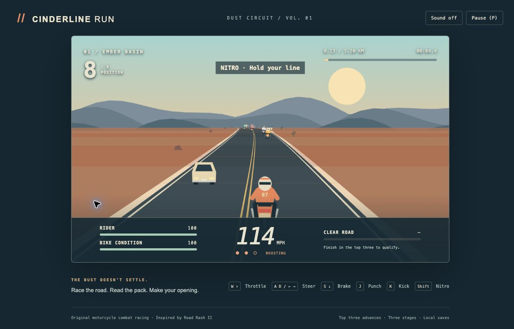

# Cinderline Run

An original browser motorcycle combat racer inspired by **Road Rash II**. Ride a winding, rolling two-lane desert highway from behind the motorcycle; weave through traffic, pass seven rivals, punch or kick nearby riders, and get back to your bike after a fall. Finish third or better to qualify for the next of three stages.



Original procedural art, names, setting, UI and synthesized engine audio. No ROMs, ripped sprites, recordings, logos or game assets. Unaffiliated with Electronic Arts or Sega.

## Play locally

Requires Node.js 22.12+ (Node 24 recommended) and npm.

```sh
npm ci
npm run build
npm run preview
```

Open **http://127.0.0.1:5219**. The server binds to loopback, never a public interface. `--strictPort` prevents silently taking another preview's port. If occupied, choose another explicitly: `npm run preview -- --port 5220`. `npm run dev` provides development hot reload.

| Action | Keyboard |
| --- | --- |
| Accelerate continuously | Hold W or Up |
| Brake / stop running back | Hold S or Down |
| Steer continuously / adjust return path | A/D or Left/Right |
| Punch nearest rider | J (hold to repeat) |
| Kick nearest rider away | K (hold to repeat) |
| Nitro burst | Shift, while moving; three charges per race |
| Start / continue after results | Enter |
| Pause / resume | P or Escape |

Punches reduce rider stamina; kicks create space. Close riders attack back. Stay alongside within reach; attacks cannot hit distant riders. The rival stamina gauge shows the nearest rider. Off-road riding slows you; riding far onto the shoulder at speed can throw you. Traffic collisions and exhausted stamina cause a crash. After the slide, your rider automatically returns; steering adjusts that route and braking waits. Rivals continue racing. A brief shield protects a remount. Five falls wreck the bike, ending that attempt. Retry costs nothing.

Ember Basin (3.2 km), Copper Divide (3.8 km), and Last Light Pass (4.4 km) increase curve severity, grades, traffic and rival pace. Qualification and best elapsed times save in this browser under the namespaced `cinderline-run:v1` key. No existing game saves are read or modified. If browser storage is unavailable, the session remains playable. Clear only that key to reset progress. Touch buttons are a convenience; desktop keyboard is the primary tested control scheme.

## Validation

```sh
npm run typecheck
npm test
npm run build
```

Behavioral tests exercise the same `Race.update(dt, input)` simulation as the keyboard game: speed, steering, centrifugal drift, traffic, attack reach, rival knockdowns and retaliation, crash return/brake/remount, wrecking, nitro, finish order, qualification, save validation, pause and a complete simulated input-driven race. GitHub Actions runs these checks on pushes and pull requests. See [QA evidence](docs/QA.md) for actual browser checks and limits.

## Design and fidelity

Research preceded implementation. The [original EA manual](https://segaretro.org/images/b/b0/Road_Rash_2_MD_US_Manual.pdf), printed pp. 2–3, 10–13 and 17–18, grounds the controls, racing loop, dashboard and road design. A [contemporary EGM developer interview](https://retrocdn.net/images/9/93/EGM_US_042.pdf), January 1993, pp. 126–127, supports distinct rival personalities. [Research notes](docs/RESEARCH.md) distinguish verified mechanics, approximations and omissions; [design spec](docs/SPEC.md) records the bounded scope.

This is a short single-player slice, not the complete original campaign. No police, weapons/stealing, shop, economy, split screen, jump physics or original tracks. Recovery, AI and handling use deliberately simplified rules. Actual original game execution and frame-for-frame physics comparison were not performed.

## Engineering

TypeScript + Vite + Canvas 2D, with no runtime dependencies or remote assets. Fixed 120 Hz simulation, bounded substeps and render projection independent of gameplay. `src/race.ts` owns mechanics and validated save data, `src/render.ts` owns perspective art, and `src/main.ts` binds normal controls and DOM UI. Standards and vocabulary live in [AGENTS.md](AGENTS.md) and [CONTEXT.md](CONTEXT.md).

The `.gitignore` embeds the official GitHub Global **Linux, Windows and macOS** templates, with source links, plus build, dependency, environment, log and local QA exclusions. Full [MIT license](LICENSE).
